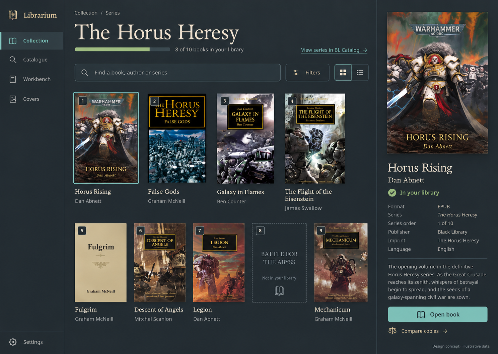
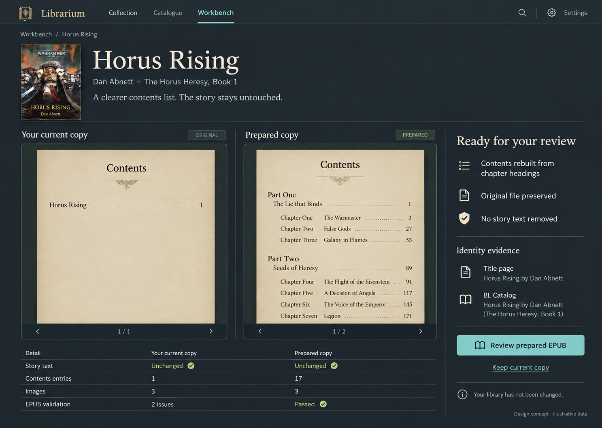
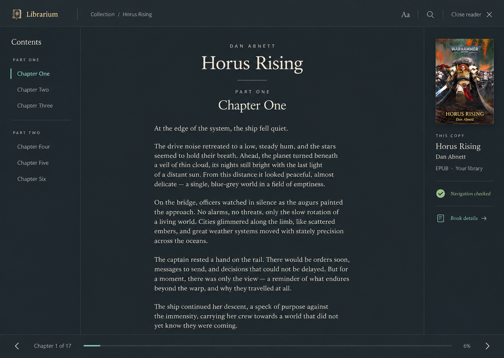

# Librarium inspiration

Three generated product concepts from 2026-10-24. These are visual explorations,
not screenshots of a working application or an approved final design. Titles,
covers, statistics, progress, and quality claims are illustrative.

## 1. Collection Atlas

Library browsing, collection structure, and a considered overview.

## 2. Book Atelier

A focused workspace for examining and preparing one book.

## 3. Reading Room

A personal, editorial presentation of the collection.

These files were copied with matching SHA-256 hashes from the initial
`library-finish/images/inspiration/` copies; those originals remain unchanged.
The shared [design brief](../../DESIGN.md) owns the current direction and caveats.
